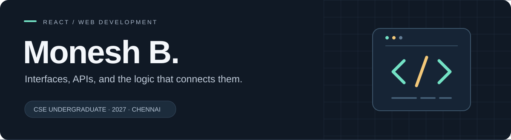

  

  <a href="https://www.linkedin.com/in/monesh-b-053439289/"><strong>LinkedIn</strong></a>
  &nbsp; / &nbsp;
  <a href="mailto:2005.monesh@gmail.com"><strong>Email</strong></a>
  &nbsp; / &nbsp;
  <a href="https://github.com/BMonesh/ForgeSavant"><strong>Featured project</strong></a>

## Hello, I'm Monesh — Full-Stack Developer

I'm studying **Computer Science & Engineering (Software Product Engineering) at VELS University, Chennai**, with graduation expected in **2027**.

I work across frontend interfaces, backend APIs, and databases to build complete applications. My project stack includes React, Node.js, Express, and MongoDB, and I'm flexible about the technologies and responsibilities a project needs. I'm currently improving **ForgeSavant**, with a focus on compatibility logic, testing, and a dependable user experience.

**Open to full-stack, frontend, backend, and broader software development internships and entry-level opportunities** in Chennai, Bengaluru, and southern India.

## Featured work

### [ForgeSavant ↗](https://github.com/BMonesh/ForgeSavant)
**A guided workspace for planning a custom PC build.**

Choose hardware, review component compatibility, and save configurations. The project connects a React interface with an Express API and MongoDB catalog.

- **Interface & workflow:** guided component selection with dependency-based filtering.
- **Application stack:** React frontend, Express REST API, and MongoDB catalog.
- **AI integration:** Gemini-powered performance estimates in the original version.
- **Active development:** compatibility validation, testing, and a streamlined build-planning experience.

[Explore the code](https://github.com/BMonesh/ForgeSavant) · [Try the preview](https://forgesavant-preview.onrender.com/)

The preview may take a moment to wake up. Generated estimates and sample planning data should not be treated as validated benchmarks or current retailer quotes.

## Technologies I work with

| Area | Technologies |
| :--- | :--- |
| Interfaces | React · JavaScript · HTML · CSS |
| Backend & APIs | REST APIs · Node.js · Express |
| Data & integrations | MongoDB · Python · Gemini API |

## Background & focus

- **Experience:** Software Engineering Intern at **Clari**, September 2024–January 2025.
- **Focus:** full-stack applications, API integrations, database-backed workflows, and user interfaces.
- **Building:** **ForgeSavant**, connecting hardware selection, compatibility checks, and saved PC configurations.
- **Interests:** product engineering, backend services, and AI-powered applications.

---

**Let's connect.** For opportunities or project discussions, reach me on [LinkedIn](https://www.linkedin.com/in/monesh-b-053439289/) or [email](mailto:2005.monesh@gmail.com).
